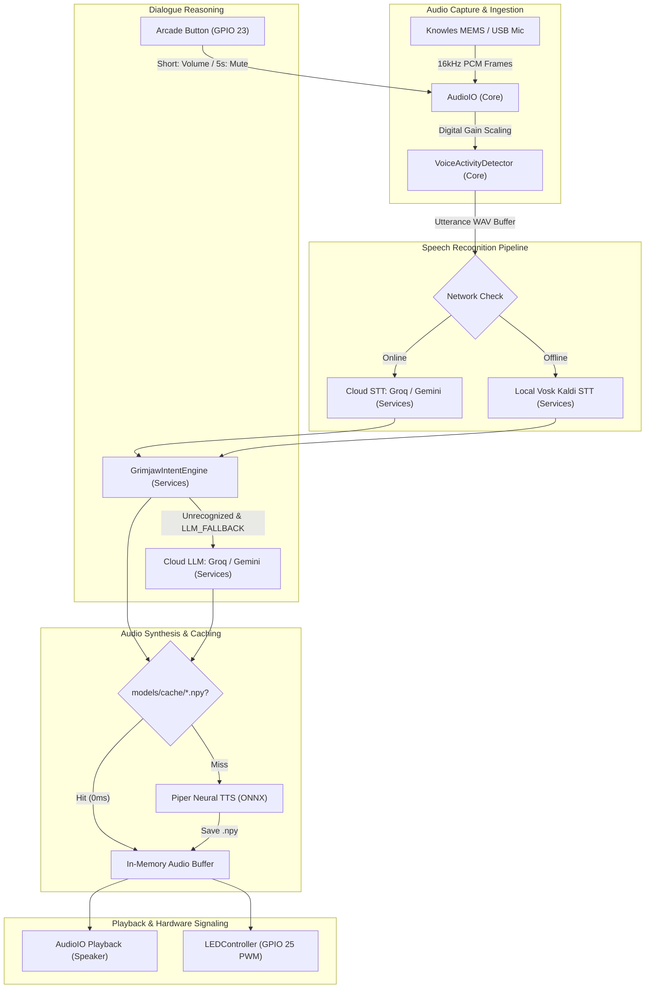
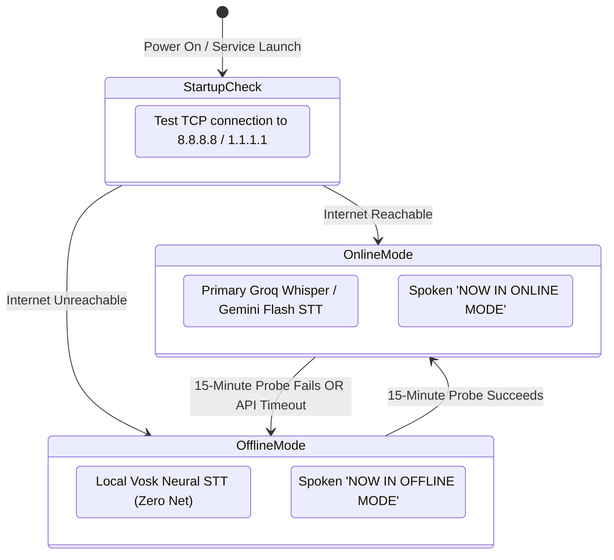

# AlsaGeist Architecture

This document describes the software and hardware architecture of **AlsaGeist**, an autonomous, hands-free conversational display engine driven by pluggable personality profiles (defaulting to Grimjaw the Crypt Skeleton).

---

## 1. System Overview

AlsaGeist runs an event-driven speech-interaction pipeline on resource-constrained single-board computers (such as the Raspberry Pi 3 Model B with Google AIY Voice HAT) and desktop workstations (macOS/Linux). 

The system operates across three operational modes:
* **Hybrid Mode (Default):** Cloud STT (Groq Whisper Large v3 / Gemini Flash) paired with local deterministic intent matching, Piper neural TTS, and RAM/disk audio caching. Optional `LLM_FALLBACK` allows indeterminate prompts to escalate to custom cloud LLM responses.
* **Autonomous Offline Mode:** 100% internet-disconnected operation using a local Vosk Kaldi neural STT engine, local rule-based intent reasoning, and cached audio playback.
* **Interactive Button Mode:** Physical arcade push-button interrupt providing 10% volume cycling on short press and a 5-second hold toggle for muting/disabling the display.



---

## 2. Layered Architecture

AlsaGeist follows the dev ADR modular architecture standard (`core/`, `services/`, and `scripts/`).

| Layer | Placement | Responsibility | Dependencies |
| :--- | :--- | :--- | :--- |
| **Orchestration** | `main.py` | CLI parsing, signal handling, periodic network polling, utterance event loop, and subsystem lifecycle. | `core`, `services` |
| **Core Utilities** | `core/` | Cross-platform hardware interfaces: ALSA/CoreAudio streaming, voice activity detection, PWM LED driver, and structured JSONL interaction logging. | `sounddevice`, `numpy`, `gpiozero`, `lgpio` |
| **Domain Services** | `services/` | Speech-to-text conversion (cloud and offline), deterministic intent classification, costume inquiry state machine, optional cloud LLM fallback, and Piper neural TTS synthesis. | `vosk`, `piper-tts`, `onnxruntime` |
| **Entry Points & Tools**| `scripts/` | Standalone CLI tools for system configuration, voice previewing, and audio cache pre-warming. | Standard library, `argparse` |

---

## 3. Subsystem Breakdown

### 3.1 Audio Input/Output (`core/audio_io.py`)
* **In-Memory Streaming:** Audio capture and playback utilize non-blocking callback queues through `sounddevice` and PortAudio. All audio remains in 32-bit floating point NumPy arrays without temporary file creation.
* **Hardware Adaptation & Resampling:** Hardware I2S DACs (such as the MAX98357A on the AIY Voice HAT) enforce fixed 44.1 kHz or 48 kHz clocks. `AudioIO` automatically downmixes stereo microphone input to mono and applies in-memory linear interpolation resampling from 22.05 kHz to 44.1 kHz during playback.
* **Software Volume & Digital Gain:**
  $$\text{Input Frame} = \text{np.clip}(\text{frame} \times \text{mic\_gain}, -1.0, 1.0)$$
  $$\text{Output Frame} = \text{np.clip}(\text{frame} \times \text{volume}, -1.0, 1.0)$$
* **Acoustic Self-Muting:** When speech playback begins, microphone capture is muted and flushed to eliminate self-triggering feedback loops.

### 3.2 Voice Activity Detection (`core/vad.py`)
* **Energy-Based Frame Processing:** Calculates Root Mean Square (RMS) energy over sliding 30ms frames (480 samples at 16 kHz).
* **Threshold Triggering:** Requires sustained speech energy above `min_energy_threshold` (default: `0.0025`) across multiple consecutive frames to trigger an active utterance state.
* **Silence Boundary Window:** Concludes an utterance once continuous trailing silence exceeds `silence_timeout_sec` (default: 0.9s), rejecting noise bursts under 0.15 seconds.

### 3.3 Status & Audio-Reactive LED Controller (`core/led_controller.py`)
* **State Machine & Signaling:**
  * `IDLE`: Smooth 0.5 Hz sinusoidal breathing pulse between 5% and 85% duty cycle (resting on porch).
  * `LISTENING`: Solid 100% illumination during active speech capture.
  * `FLASH (Speech Acknowledged)`: 3 rapid full-brightness pulses (~7 Hz) immediately upon speech capture completion to confirm the utterance was heard prior to translation.
  * `THINKING (Processing)`: Heartbeat double-pulse (~1.1 Hz "lub-dub... pause") active while transcribing speech, classifying intent, fetching LLM fallback responses, and synthesizing TTS audio.
  * `SPEAKING`: 3–4 Hz organic syllable-cadence pulsing synchronized with spoken dialogue.
  * `ERROR`: Rapid 5 Hz square-wave alert blinking.
  * `OFF`: 0% duty cycle when system is stopped or muted/disabled via button hold.
* **Arcade Button Event Detection:**
  * `Short Press (< 5.0s)`: Step volume by 10%, stop playback, and announce new level. Ignored while disabled.
  * `Long Hold (5.0s)`: Toggle mute/disabled state. Disabling cuts microphone capture and audio playback, resets dialogue context, and turns off the LED. Re-enabling restores capture, resets VAD, and turns the LED back to `IDLE` breathing mode. A latch prevents short press invocation on release of a 5-second hold.
* **Driver Hierarchy:** Uses `gpiozero.PWMLED` and `Button` backed by `rpi-lgpio` on modern Debian Bookworm kernels, with automatic fallback to `RPi.GPIO` on legacy releases, and a colorized terminal simulator on macOS workstations.

### 3.4 Speech-to-Text Engine (`services/stt_service.py`)
* **Multi-Backend Fallback:**
  1. *Groq Whisper Large v3:* Sub-2-second cloud transcription over HTTPS.
  2. *Gemini Flash Audio:* Multimodal cloud fallback.
  3. *Vosk Kaldi Neural Engine (`vosk-model-small-en-us-0.15`):* 100% offline speech recognition executing locally in RAM with zero external network connectivity.
* **Gain Normalization:** Normalizes raw audio buffers to a 0.85 peak before WAV header generation to maximize phoneme clarity.

### 3.5 Intent & Character Dialogue Engine (`services/intent_service.py`)
* **Deterministic Classification:** Evaluates transcribed input against over 150 compiled regular expression patterns covering 225+ character responses, candy protection rules, pop-culture quotes, and puns.
* **Costume & Character Banter:** 46 distinct 1-to-1 character rules (KPop Demon Hunters, Bluey, Mario, Luigi, Peach, Yoshi, Baby Yoda, Eevee, Toy Story, Frozen, Moana, Mickey, Minnie, Cinderella, DC/Marvel superheroes, Sonic, Minecraft Steve, SpongeBob, Barbie, TMNT, Harry Potter, PAW Patrol).
* **Visitor Context & Session Timing:**
  * Resets dialogue turn counters (`_turn_count = 0`) after 10 seconds of ambient silence.
  * Resets session immediately upon delivering a "scram / go away" escalation or receiving farewell phrases.
* **Costume Inquiry State Machine:**
  * Once a conversation is initiated (`turn_count >= 2`), Grimjaw has a 1-in-3 chance to ask the visitor who they are dressed as.
  * Prompts at most once per visitor session (`_asked_costume` flag) and resets when the visitor leaves.
* **LLM Fallback Escalation (`LLM_FALLBACK`):**
  * When `LLM_FALLBACK=true`, indeterminate prompts matching `fallback_unrecognized` escalate to `ConversationalLLMService` for custom character generation.
  * If offline or if the LLM request errors/times out, seamlessly degrades to deterministic generic fallback lines.

### 3.6 Neural TTS & Audio Caching (`services/tts_service.py`)
* **Local Neural Synthesis:** Uses Piper ONNX (`en_GB-alan-medium.onnx`) with runtime phonetic normalization for character pronunciations.
* **Two-Tier Audio Caching:**
  1. *Tier 1 (RAM Cache):* In-memory Python dictionary storing previously synthesized audio arrays for 0 ms repeated playback.
  2. *Tier 2 (Disk Cache):* MD5-keyed float32 NumPy arrays stored in `models/cache/<hash>.npy`. Caches persist across reboots, providing 0 ms time-to-first-byte (TTFB) playback for all pre-warmed dialogue lines.

---

## 4. Connectivity & Network State Machine

AlsaGeist monitors network status and transitions dynamically between cloud-enhanced and offline modes:



---

## 5. Physical Hardware & Pinout Reference

For the standard Google AIY Voice Kit V1 (Raspberry Pi 40-Pin Header):

| Signal | BCM GPIO | Physical Header Pin | Electrical Characteristics |
| :--- | :--- | :--- | :--- |
| **Arcade Button LED** | GPIO 25 | Pin 22 | Hardware PWM Output (3.3V) |
| **Arcade Button Switch** | GPIO 23 | Pin 16 | Digital Input (Internal Pull-Up, Active LOW) |
| **I2S Bit Clock (BCLK)** | GPIO 18 | Pin 12 | ALSA Sound Card I2S Clock |
| **I2S Frame Sync (LRCLK)**| GPIO 19 | Pin 35 | ALSA Sound Card Word Clock |
| **I2S Data In (DIN)** | GPIO 20 | Pin 38 | Knowles MEMS Microphone Input |
| **I2S Data Out (DOUT)** | GPIO 21 | Pin 40 | MAX98357A Amplified Speaker Output |
| **Power Rails** | 3.3V / 5.0V / GND | Pins 1, 2, 6, 9 | Regulated DC supply |

---

## 6. Directory Layout & Key Files

```text
alsageist/
├── core/
│   ├── audio_io.py                # Sounddevice capture, resampling & playback
│   ├── led_controller.py          # GPIO PWM breathing, solid & speech flutter
│   ├── logger.py                  # Structured JSONL telemetry logger
│   └── vad.py                     # Energy VAD & silence boundary detector
├── services/
│   ├── intent_service.py          # Deterministic dialogue rules & costume state machine
│   ├── llm_service.py             # Optional cloud LLM fallback service
│   ├── stt_service.py             # Groq, Gemini & offline Vosk speech recognition
│   └── tts_service.py             # Piper neural TTS & disk/memory cache
├── models/
│   ├── cache/                     # Pre-warmed .npy audio cache files (0ms TTFB)
│   ├── piper/                     # en_GB-alan-medium.onnx neural voice model
│   └── vosk-model-small-en-us/    # Offline speech recognition neural model
├── scripts/
│   ├── configure_rpi_os.sh        # System setup script (ALSA, group, overlay)
│   └── prewarm_cache.py           # Batch offline audio cache synthesizer
├── docs/
│   ├── architecture.md            # System architecture document
│   ├── custom_responses.md        # Intent response catalogue
│   ├── raspberry_pi_installation_guide.md # End-to-end OS setup & deployment guide
│   └── spec.md                    # Product specification & scope
├── tests/                         # Unit tests covering all subsystems
├── main.py                        # Autonomous runtime entry point
├── pyproject.toml                 # Package definition & entry point
└── alsageist.service              # Systemd unit file template
```
