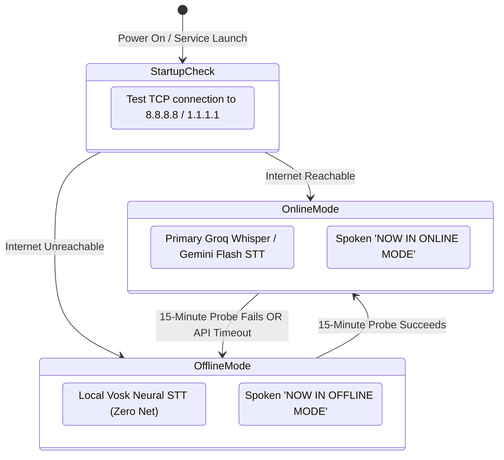

# AlsaGeist Architecture

This document describes the software and hardware architecture of **AlsaGeist**, an autonomous, hands-free conversational display engine driven by pluggable personality profiles (defaulting to Grimjaw the Crypt Skeleton).

---

## 1. System Overview

AlsaGeist runs an event-driven speech-interaction pipeline on resource-constrained single-board computers (such as the Raspberry Pi 3 Model B with Google AIY Voice HAT) and desktop workstations (macOS/Linux). 

The system operates across two operational modes:
* **Hybrid Mode (Default):** Cloud STT (Groq Whisper Large v3 / Gemini Flash) paired with local deterministic intent matching, Piper neural TTS, and RAM/disk audio caching. Optional `LLM_FALLBACK` allows indeterminate prompts to escalate to custom cloud LLM responses.
* **Autonomous Offline Mode:** 100% internet-disconnected operation using a local Vosk Kaldi neural STT engine, local rule-based intent reasoning, and cached audio playback.


---

## 2. Layered Architecture

AlsaGeist follows the dev ADR modular architecture standard (`core/`, `services/`, and `scripts/`).

| Layer | Placement | Responsibility | Dependencies |
| :--- | :--- | :--- | :--- |
| **Orchestration** | `services/agent.py` | Subsystem lifecycle, periodic network polling, the decomposed utterance event loop (`_filter_utterance`, `_resolve_dialogue_response`, `_play_speech_audio`, `speak`), and the thread-safe control API used by the button handlers and the IPC server. | `core`, `services` |
| **Runtime Entry Point** | `main.py` | Argument parsing, `.env` loading, signal handlers, and agent start. | `core`, `services` |
| **Configuration** | `core/config.py` | Centralized command-line argument parser (`parse_args`, `build_arg_parser`), environment variable default resolution, and semantic version constants. | Standard library, `argparse` |
| **System Utilities** | `core/system_utils.py` | Host and operating system utilities: `.env` file parsing, TCP network connectivity probing, and platform-safe operating system shutdown triggers. | Standard library, `socket`, `subprocess` |
| **Core Subsystems** | `core/` | Cross-platform hardware interfaces and IPC: ALSA/CoreAudio streaming (`audio_io.py`), voice activity detection (`vad.py`), PWM LED driver (`led_controller.py`), structured JSONL interaction logging (`logger.py`), personality profile parsing (`intent_builder.py`), Unix domain socket IPC daemon server (`control_server.py`), and HTTP transport with Groq/Gemini API wrappers (`http_client.py`, `cloud_api.py`). | `sounddevice`, `numpy`, `gpiozero`, `lgpio` |
| **Domain Services** | `services/` | Speech-to-text conversion (cloud and offline), deterministic intent classification, costume inquiry state machine, optional cloud LLM fallback, and Piper neural TTS synthesis. | `vosk`, `piper-tts`, `onnxruntime` |
| **Entry Points & Tools**| `scripts/` | Standalone CLI tools for system configuration, daemon control, voice synthesis previewing, and audio cache pre-warming. | Standard library, `argparse` |

---

## 3. Subsystem Breakdown

### 3.1 Configuration & Argument Parser (`core/config.py`)
* **Decoupled CLI Definition:** Encapsulates argument specifications and `--help` / `--version` flags away from application entry points.
* **Environment Fallbacks:** Parameterizes audio thresholds, device names, personality profile selection, volume, and pin allocations from shell environment variables (e.g., `$PERSONALITY`, `$VOLUME`, `$VAD_THRESHOLD`, `$LED_PIN`).
* **Testability:** Exposes `parse_args(args=None)` accepting custom parameter arrays to allow headless testing without polluting `sys.argv`.

### 3.2 Host & Operating System Utilities (`core/system_utils.py`)
* **Environment Loading (`load_env_file`):** Robust key-value `.env` parser that ignores comments, strips enclosing quotes, skips duplicate keys, and resolves paths without third-party dependencies.
* **Network Connectivity Probing (`check_internet_connectivity`):** Low-overhead direct TCP socket connection check against `1.1.1.1` and `8.8.8.8` on port 443, then port 53, avoiding DNS lookups and ICMP ping permissions. Periodic checks run on a background thread.
* **Host Power Management (`trigger_host_shutdown`):** Safe system shutdown dispatch executing `sudo /sbin/shutdown -h now` on Linux platforms while safely simulating actions in dry-run mode on macOS development machines.

### 3.3 Audio Input/Output (`core/audio_io.py`)
* **In-Memory Audio:** Audio capture runs through non-blocking callback queues in `sounddevice` and PortAudio. Playback, synthesis, and transcription operate on complete utterances. All audio remains in 32-bit floating point NumPy arrays without temporary file creation.
* **Hardware Adaptation & Resampling:** Hardware I2S DACs (such as the MAX98357A on the AIY Voice HAT) enforce fixed 44.1 kHz or 48 kHz clocks. `AudioIO` automatically downmixes stereo microphone input to mono and applies in-memory linear interpolation resampling from 22.05 kHz to 44.1 kHz during playback.
* **Software Volume & Digital Gain:**
  $$\text{Input Frame} = \text{np.clip}(\text{frame} \times \text{mic\_gain}, -1.0, 1.0)$$
  $$\text{Output Frame} = \text{np.clip}(\text{frame} \times \text{volume}, -1.0, 1.0)$$
* **Acoustic Self-Muting:** When speech playback begins, microphone capture is muted and flushed to eliminate self-triggering feedback loops.

### 3.4 Voice Activity Detection (`core/vad.py`)
* **Energy-Based Frame Processing:** Calculates Root Mean Square (RMS) energy over sliding 30ms frames (480 samples at 16 kHz).
* **Threshold Triggering:** Requires sustained speech energy above `min_energy_threshold` (default: `0.0025`) across multiple consecutive frames to trigger an active utterance state.
* **Silence Boundary Window:** Concludes an utterance once continuous trailing silence exceeds `silence_timeout_sec` (default: 0.9s), rejecting noise bursts under 0.15 seconds.

### 3.5 Status & Audio-Reactive LED Controller (`core/led_controller.py`)
* **State Machine & Signaling:**
  * `IDLE`: Smooth 0.5 Hz sinusoidal breathing pulse between 5% and 85% duty cycle (resting on porch).
  * `LISTENING`: Solid 100% illumination during active speech capture.
  * `FLASH (Speech Acknowledged)`: 3 rapid full-brightness pulses (~7 Hz) immediately upon speech capture completion to confirm the utterance was heard prior to translation.
  * `THINKING (Processing)`: Heartbeat double-pulse (~1.1 Hz "lub-dub... pause") active while transcribing speech, classifying intent, fetching LLM fallback responses, and synthesizing TTS audio.
  * `SPEAKING`: 3–4 Hz organic syllable-cadence pulsing synchronized with spoken dialogue.
  * `ERROR`: Rapid 5 Hz square-wave alert blinking.
  * `OFF`: 0% duty cycle when system is stopped or muted/disabled via button hold.
* **Arcade Button Event Detection:**
  * `Short Press (< 5.0s)`: Step volume by 10%, stop playback, and announce new level. Ignored while disabled.
  * `Medium Hold (5.0s)`: Toggle mute/disabled state. Disabling cuts microphone capture and audio playback, resets dialogue context, and turns off the LED. Re-enabling restores capture, resets VAD, and turns the LED back to `IDLE` breathing mode.
  * `Long Hold (10.0s)`: Announce offline pre-cached "Powering off.", extinguish LED, and invoke `trigger_host_shutdown()` to cleanly power down the operating system.
* **Driver Hierarchy:** Uses `gpiozero.PWMLED` and `Button` backed by `rpi-lgpio` on modern Debian Bookworm kernels, with automatic fallback to `RPi.GPIO` on legacy releases, and a colorized terminal simulator on macOS workstations.

### 3.6 Speech-to-Text Engine (`services/stt_service.py`)
* **Multi-Backend Fallback:**
  1. *Groq Whisper Large v3:* Sub-2-second cloud transcription over HTTPS.
  2. *Gemini Flash Audio:* Multimodal cloud fallback.
  3. *Vosk Kaldi Neural Engine (`vosk-model-small-en-us-0.15`):* 100% offline speech recognition executing locally in RAM with zero external network connectivity.
* **Gain Normalization:** Normalizes raw audio buffers to a 0.85 peak before WAV header generation to maximize phoneme clarity.

### 3.7 Intent & Character Dialogue Engine (`services/intent_service.py`)
* **Deterministic Classification:** Evaluates transcribed input against over 150 compiled regular expression patterns covering 225+ character responses, candy protection rules, pop-culture quotes, and puns.
* **Costume & Character Banter:** 46 distinct 1-to-1 character rules (KPop Demon Hunters, Bluey, Mario, Luigi, Peach, Yoshi, Baby Yoda, Eevee, Toy Story, Frozen, Moana, Mickey, Minnie, Cinderella, DC/Marvel superheroes, Sonic, Minecraft Steve, SpongeBob, Barbie, TMNT, Harry Potter, PAW Patrol).
* **Visitor Context & Session Timing:**
  * Resets dialogue turn counters (`_turn_count = 0`) after 10 seconds of ambient silence.
  * Resets session immediately upon delivering a "scram / go away" escalation or receiving farewell phrases.
* **Costume Inquiry State Machine:**
  * Once a conversation is initiated (`turn_count >= 2`), Grimjaw has a 1-in-3 chance to ask the visitor who they are dressed as.
  * Prompts at most once per visitor session (`_asked_costume` flag) and resets when the visitor leaves.
* **LLM Fallback Escalation (`LLM_FALLBACK`):**
  * When `LLM_FALLBACK=true`, indeterminate prompts matching `fallback_unrecognized` escalate to `ConversationalLLMService` for custom character generation.
  * If offline or if the LLM request errors/times out, seamlessly degrades to deterministic generic fallback lines.

### 3.8 Dynamic System & Information Provider (`services/basic_info_service.py`)
* **Hardware & Time Diagnostics:** Provides real-time spoken time announcements, weather summaries, and system operational metrics dynamically injected into the dialogue flow without cloud LLM dependencies.

### 3.9 Neural TTS & Audio Caching (`services/tts_service.py`)
* **Local Neural Synthesis:** Uses Piper ONNX (`en_GB-alan-medium.onnx`) with runtime phonetic normalization for character pronunciations.
* **Two-Tier Audio Caching:**
  1. *Tier 1 (RAM Cache):* In-memory Python dictionary storing previously synthesized audio arrays for 0 ms repeated playback.
  2. *Tier 2 (Disk Cache):* float32 NumPy arrays stored in `models/cache/<hash>.npy`, keyed by text, voice model, tempo and noise. Caches persist across reboots, providing 0 ms time-to-first-byte (TTFB) playback for all pre-warmed dialogue lines.
* **Cache Limits:** The RAM tier keeps the 128 most recently used phrases. The disk tier is capped at `$ALSAGEIST_CACHE_MAX_MB` (default 1024 MB); the least recently used files are deleted beyond the cap. Disk writes are atomic.

### 3.10 Control Server IPC (`core/control_server.py`)
* **UNIX Domain Socket Daemon:** Asynchronous control server listening on `/tmp/alsageist-<uid>/alsageist.sock`.
* **Access Control:** The socket directory is mode 0700 and the socket mode 0600, both created by the daemon user. On Linux the server also checks the peer UID (`SO_PEERCRED`) and accepts only the daemon user or root. A path that exists but is not a socket owned by the daemon user is never replaced. Requests are limited to 64 KB.
* **Non-Blocking Control Interface:** Processes commands (`STATUS`, `VOLUME`, `MUTE`, `UNMUTE`, `DISABLE`, `ENABLE`, `TOGGLE`, `SAY`, `MODE`, `PERSONALITY`, `SHUTDOWN`) dispatched from `scripts/alsageist_ctl.py` without interrupting the active audio loop.
* **Agent API Only:** Every command calls a public method on the agent (`disable`, `enable`, `toggle`, `speak`, `set_volume`, `set_online`, `switch_personality`, `request_shutdown`). The server holds no audio, VAD, or LED logic.

### 3.11 Conversational Orchestration Pipeline (`services/agent.py`)
* **Decomposed Utterance Lifecycle:**
  1. *Utterance Filtering (`_filter_utterance`):* Filters empty silence, sub-threshold ambient noises, timecode strings, and common whisper artifacts.
  2. *Dialogue Resolution (`_resolve_dialogue_response`):* Resolves intent classification, handles dynamic time/weather intents, and coordinates cloud LLM fallback escalation.
  3. *Audio Synthesis & Playback (`_play_speech_audio` / `speak`):* Synthesizes audio in RAM, sets `LEDState.SPEAKING`, mutes microphone capture during playback, and applies an acoustic dissipation cooldown before unmuting. Reused cleanly across mode announcements, button interactions, startup greetings, and dialogue replies.
* **Concurrency:** State changes (`disable`, `enable`, `toggle`, `switch_personality`) hold a state lock. Speech playback holds an audio lock, so button, IPC, and dialogue speech play one clip at a time.
* **Persona Switching:** `switch_personality` builds the new dialogue engine, LLM prompt, voice, and info service before installing any of them; a failure leaves the running persona unchanged.

---

## 4. Connectivity & Network State Machine

AlsaGeist monitors network status and transitions dynamically between cloud-enhanced and offline modes:



---

## 5. Physical Hardware & Pinout Reference

For the standard Google AIY Voice Kit V1 (Raspberry Pi 40-Pin Header):

| Signal | BCM GPIO | Physical Header Pin | Electrical Characteristics |
| :--- | :--- | :--- | :--- |
| **Arcade Button LED** | GPIO 25 | Pin 22 | Hardware PWM Output (3.3V) |
| **Arcade Button Switch** | GPIO 23 | Pin 16 | Digital Input (Internal Pull-Up, Active LOW) |
| **I2S Bit Clock (BCLK)** | GPIO 18 | Pin 12 | ALSA Sound Card I2S Clock |
| **I2S Frame Sync (LRCLK)**| GPIO 19 | Pin 35 | ALSA Sound Card Word Clock |
| **I2S Data In (DIN)** | GPIO 20 | Pin 38 | Knowles MEMS Microphone Input |
| **I2S Data Out (DOUT)** | GPIO 21 | Pin 40 | MAX98357A Amplified Speaker Output |
| **Power Rails** | 3.3V / 5.0V / GND | Pins 1, 2, 6, 9 | Regulated DC supply |

---

## 6. Directory Layout & Key Files

```text
alsageist/
├── core/
│   ├── audio_io.py                # Sounddevice capture, resampling & playback
│   ├── config.py                  # CLI argument parser, schema & version definition
│   ├── control_server.py          # Asynchronous UNIX domain socket IPC daemon server
│   ├── cloud_api.py               # Groq & Gemini endpoint wrappers
│   ├── http_client.py             # JSON & multipart HTTP client with mandatory timeouts
│   ├── intent_builder.py          # Personality profile loader & intent dataclass schema
│   ├── led_controller.py          # GPIO PWM breathing, solid & speech flutter
│   ├── logger.py                  # Structured JSONL telemetry logger (rotation, optional text redaction)
│   ├── system_utils.py            # Environment loader, TCP network probe & safe shutdown
│   └── vad.py                     # Energy VAD & silence boundary detector
├── services/
│   ├── agent.py                   # Agent orchestrator & control API
│   ├── basic_info_service.py      # Real-time spoken time and weather status provider
│   ├── intent_service.py          # Deterministic dialogue rules & costume state machine
│   ├── llm_service.py             # Optional cloud LLM fallback service
│   ├── stt_service.py             # Groq, Gemini & offline Vosk speech recognition
│   └── tts_service.py             # Piper neural TTS & disk/memory cache
├── data/
│   └── personalities/             # Pluggable character personality JSON profiles
├── models/
│   ├── cache/                     # Pre-warmed .npy audio cache files (0ms TTFB)
│   ├── piper/                     # en_GB-alan-medium.onnx neural voice model
│   └── vosk-model-small-en-us/    # Offline speech recognition neural model
├── scripts/
│   ├── add_intent.py              # Interactive dialogue intent builder
│   ├── alsageist_ctl.py           # UNIX socket daemon control CLI
│   ├── download_model.py          # Piper and Vosk model asset fetcher
│   ├── prewarm_cache.py           # Batch offline audio cache synthesizer
│   ├── say.py                     # Command-line TTS speech generation tool
│   ├── setup_docker.sh            # Automated Docker deployment tool
│   ├── setup_rpi_os.sh            # Host OS setup script (ALSA, group, overlay)
│   ├── setup_systemd_service.sh   # Systemd unit installation script
│   └── summarize_personality.py   # Dynamic Q&A personality prompt catalog generator
├── docs/
│   ├── architecture.md            # System architecture document
│   ├── design_spec.md             # Hardware, acoustic & conversational design specification
│   ├── getting_started_rpi_bare_metal.md # Native Python venv installation guide
│   ├── getting_started_rpi_docker.md     # Containerized Docker deployment guide
│   ├── overview.md                # Project & hardware specifications overview
│   └── usage_guide.md             # Operations & day-to-day management guide
├── tests/                         # Unit tests covering all subsystems
├── main.py                        # Runtime entry point (arguments, signals, agent start)
├── pyproject.toml                 # Package definition & entry point
└── alsageist.service              # Systemd unit file template
```
