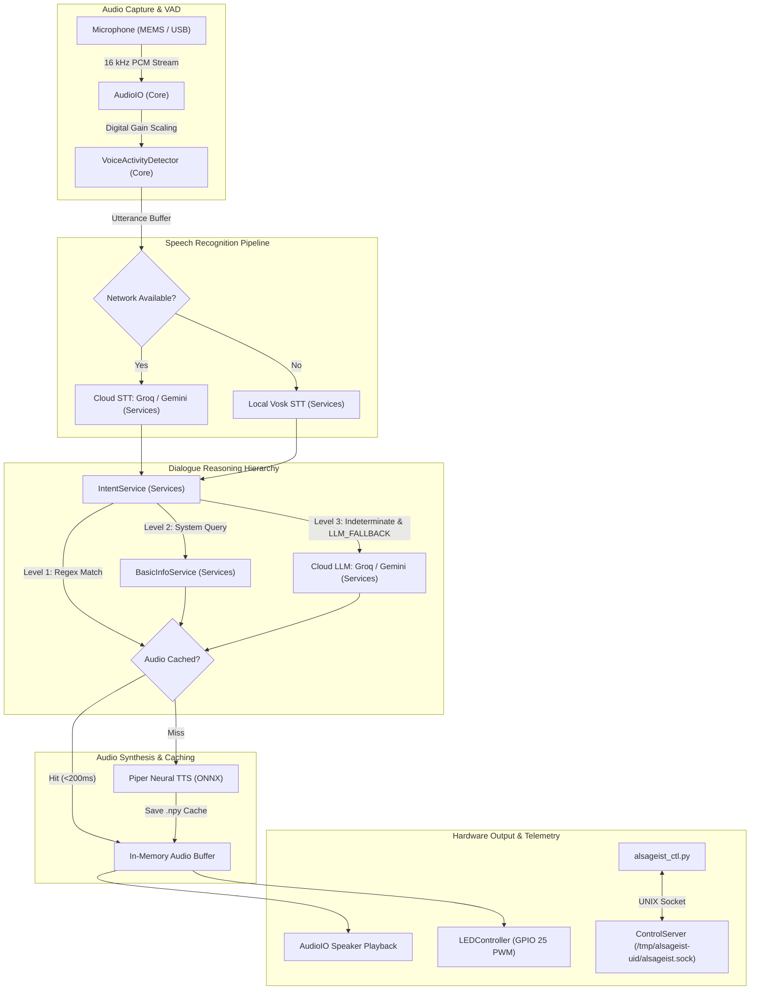

# AlsaGeist Design Specification

Technical design specification covering hardware architecture, conversational subsystems, electrical interfaces, and operational performance budgets for AlsaGeist.

---

## 1. Project Requirements & Scope

### 1.1 Hardware Scope
* **Base Controller:** Raspberry Pi 3 Model B (Quad-Core 1.2 GHz, 1 GB RAM), Pi 3B+, 4, 5, or Linux/macOS workstation.
* **Audio System:**
  * **Primary Profile (`aiy`):** Google AIY Voice Kit V1 (2017 Full-Size Voice HAT):
    * Driver overlay: `googlevoicehat-soundcard` loaded via Raspberry Pi device tree.
    * Input: Knowles stereo MEMS microphone daughterboard connected via flat flex ribbon cable.
    * Output: 3-inch 4-ohm 3W speaker connected to the Voice HAT amplified screw terminals.
  * **Alternative Profile (`usb`):** Standard USB speaker with integrated microphone.
* **Physical Controls & Indicators:**
  * AIY arcade push-button with integrated status LED wired to the Voice HAT button and LED headers.
  * Button input: BCM GPIO 23 (active-low with internal pull-up).
  * LED output: BCM GPIO 25 (hardware PWM driven).
* **Enclosure:** Life-sized resin skull prop with acoustic isolation decoupling between the speaker mount and the microphone daughterboard to prevent acoustic feedback.

### 1.2 Conversational & Software Scope
* **Modular Personality Architecture:** Pluggable JSON personality profiles in `data/personalities/` defining character prompts, regex dialogue intents, and vocal configurations. Ships with default personality **Grimjaw the Crypt Skeleton** (`data/personalities/grimjaw.json`).
* **Multi-Tier Speech Recognition (STT):**
  1. *Primary Cloud:* Groq Whisper Large v3 (sub-second cloud transcription over HTTPS).
  2. *Secondary Cloud:* Google Gemini Flash multimodal audio transcription.
  3. *Autonomous Offline:* Local Vosk Kaldi neural engine (`vosk-model-small-en-us-0.15`) running in-memory with zero network connectivity.
* **Multi-Tier Dialogue Reasoning:**
  1. *Level 1 (Deterministic Intents):* Local regex and keyword pattern matching (`services/intent_service.py`) for instant responses.
  2. *Level 2 (Local System Diagnostics):* Deterministic system metrics, hardware status, and current time (`services/basic_info_service.py`).
  3. *Level 3 (Generative LLM Fallback):* Optional cloud LLM fallback (`services/llm_service.py` using Groq LLaMA 3.3 70B or Gemini Flash) active only when `LLM_FALLBACK=true`.
* **Neural Speech Synthesis (TTS):**
  * Local Piper neural TTS engine (`models/piper/en_GB-alan-medium.onnx`) running on device.
  * In-memory pre-warmed audio cache (`models/cache/*.npy`) delivering instant (<200 ms) speech playback.
* **Zero Steady-State Disk I/O:** Audio capture, VAD segmentation, intent matching, and cache playback operate entirely in RAM NumPy arrays without writing temporary audio files to the SD card.
* **Autonomous Process Supervision:** Autonomous boot execution via systemd service or Docker Compose.

---

## 2. System Architecture & Data Flow



---

## 3. Subsystem Specifications

### 3.1 Voice Activity Detection (`core/vad.py`)
* **Sliding Window:** 30 ms frame size (480 samples at 16 kHz mono).
* **Energy Metric:** Root Mean Square (RMS) frame energy:
  $$\text{RMS} = \sqrt{\frac{1}{N} \sum_{i=1}^{N} x_i^2}$$
* **Threshold Triggering:** Activates speech state when consecutive frames exceed `min_energy_threshold` (default: `0.0035`).
* **Silence Boundary:** Utterance concludes after `silence_timeout_sec` (default: 0.9s) of continuous sub-threshold audio. Rejects noise bursts shorter than 0.15s.

### 3.2 Status LED & Push-Button Controller (`core/led_controller.py`)
* **LED Signaling States:**
  * `IDLE`: Smooth 0.5 Hz sinusoidal breathing pulse (5% to 85% duty cycle).
  * `LISTENING`: Solid 100% illumination during active microphone recording.
  * `FLASH`: 3 rapid full-brightness pulses (~7 Hz) confirming speech capture completion.
  * `THINKING`: Heartbeat double-pulse (~1.1 Hz "lub-dub... pause") active during STT transcription, intent classification, and audio synthesis.
  * `SPEAKING`: Syllable-cadence PWM flutter synchronized with spoken dialogue.
  * `ERROR`: Rapid 5 Hz square-wave alert blinking.
  * `OFF`: 0% duty cycle when system is stopped or muted/disabled via button hold.
* **Arcade Push-Button Event Handling:**
  * `Short Press (< 5.0s)`: Cycles output volume by 10%, stops active playback, and announces current volume.
  * `Medium Hold (5.0s)`: Toggles mute/disabled state. Muting cuts microphone recording, terminates playback, and sets the LED to `OFF`. Re-enabling restores capture and returns the LED to `IDLE` breathing mode.
  * `Long Hold (10.0s)`: Speaks "Powering off.", extinguishes the LED, and triggers a clean host shutdown (`system_utils.trigger_host_shutdown`).

### 3.3 IPC Control Server (`core/control_server.py`)
* **Socket Path:** `/tmp/alsageist-<uid>/alsageist.sock` or `$ALSAGEIST_SOCKET` (UNIX domain stream socket; directory mode 0700, socket mode 0600; peer UID checked on Linux).
* **Control Commands:**
  * `STATUS`: Returns JSON payload with daemon state, active personality, volume, mute state, and memory metrics.
  * `PAUSE`: Pauses microphone capture and VAD processing.
  * `RESUME`: Resumes microphone capture and VAD processing.
  * `RELOAD`: Reloads active personality JSON definitions and pre-warmed audio cache.
  * `SAY <text>`: Synthesizes and plays back specified text immediately.
  * `SET_PERSONALITY <name>`: Switches active character profile at runtime.
  * `STOP`: Initiates graceful daemon shutdown.

---

## 4. Hardware Interfaces & Pinout

| Function | BCM Pin | Physical Pin | Voice HAT Header | Electrical Characteristics |
| :--- | :--- | :--- | :--- | :--- |
| **Push-Button Input** | GPIO 23 | Pin 16 | Button Header (Pin 1) | Active-low, internal pull-up enabled |
| **Push-Button Ground** | GND | Pin 14 | Button Header (Pin 2) | Chassis ground return |
| **Status LED PWM** | GPIO 25 | Pin 22 | LED Header (Pin 1) | 3.3V logic, hardware PWM, current-limited |
| **Status LED Ground** | GND | Pin 20 | LED Header (Pin 2) | Chassis ground return |
| **I2S Bit Clock (BCLK)** | GPIO 18 | Pin 12 | 40-Pin GPIO Header | Audio bit clock for DAC and ADC |
| **I2S Frame Sync (LRCLK)**| GPIO 19 | Pin 35 | 40-Pin GPIO Header | Word clock / channel select |
| **I2S Data Out (DAC)** | GPIO 21 | Pin 40 | 40-Pin GPIO Header | Serial audio data to MAX98357A amp |
| **I2S Data In (ADC)** | GPIO 20 | Pin 38 | 40-Pin GPIO Header | Serial audio data from MEMS daughterboard |

---

## 5. Acoustic & Latency Budgets

| Metric | Target Budget | Observed Performance (RPi 3B) | Impact / Mitigation |
| :--- | :--- | :--- | :--- |
| **Cached Intent Playback TTFB** | < 200 ms | 90–140 ms | Zero perceptual lag; instant snappy response |
| **Cloud STT Latency (Groq)** | < 1,500 ms | 600–1,100 ms | In-memory WAV upload over HTTPS |
| **Offline STT Latency (Vosk)** | < 2,500 ms | 1,200–2,100 ms | In-memory 16 kHz stream; no cloud round-trip |
| **Uncached Piper TTS Synthesis** | < 6,000 ms | 4,200–5,500 ms | High latency on Pi 3; mitigated by offline pre-warming cache |
| **Daemon Resident Memory (RAM)** | < 450 MB | 280–380 MB | Fits comfortably within 1 GB physical RAM |
| **Idle CPU Utilization** | < 5% | 2–4% | Energy VAD operates efficiently on 1 core |
| **Active Speech Capture CPU** | < 25% | 12–18% | Audio frame queue and RMS sliding window |

---

## 6. Modular Codebase Layout

```
alsageist/
├── core/
│   ├── __init__.py
│   ├── audio_io.py              # Cross-platform in-memory capture & playback (CoreAudio / ALSA)
│   ├── config.py                # Command-line argument parser, version & defaults
│   ├── cloud_api.py             # Groq & Gemini endpoint wrappers
│   ├── control_server.py        # UNIX socket IPC control server for runtime management
│   ├── http_client.py           # JSON & multipart HTTP client with mandatory timeouts
│   ├── intent_builder.py        # Offline intent file compiler & parser
│   ├── led_controller.py        # Hardware RPi.GPIO PWM & terminal visualizer
│   ├── logger.py                # ADR 0020 compliant color terminal logging
│   ├── system_utils.py          # System diagnostic & memory helper utilities
│   └── vad.py                   # Energy-based voice activity & silence boundary detector
├── services/
│   ├── __init__.py
│   ├── agent.py                 # Agent orchestrator & control API
│   ├── basic_info_service.py    # Deterministic local system info & time provider
│   ├── intent_service.py        # Local regex & keyword instant response matcher
│   ├── llm_service.py           # Persona dialogue reasoning engine (Groq / Gemini)
│   ├── stt_service.py           # In-memory speech-to-text (Groq Whisper / Gemini / Vosk)
│   └── tts_service.py           # Local Piper neural TTS engine in RAM
├── models/
│   ├── cache/                   # Pre-warmed .npy audio arrays for zero-latency responses
│   ├── piper/                   # en_GB-alan-medium.onnx neural voice model & config
│   └── vosk-model-small-en-us/  # Offline speech recognition neural model
├── data/
│   └── personalities/           # Character personality profile definitions (grimjaw.json)
├── scripts/
│   ├── add_intent.py            # Interactive CLI for creating structured intent definitions
│   ├── alsageist_ctl.py         # IPC client for querying and controlling daemon status
│   ├── download_model.py        # Model asset fetcher with integrity verification
│   ├── prewarm_cache.py         # Offline response pre-synthesis cache warmer
│   ├── say.py                   # Command-line TTS speech generation tool
│   ├── setup_docker.sh          # Automated Docker engine and compose installer
│   ├── setup_rpi_os.sh          # Automated host OS setup and soundcard configuration
│   ├── setup_systemd_service.sh # Systemd unit installation script
│   └── summarize_personality.py # Dynamic personality Q&A catalog generator
├── tests/                       # Automated test suite
├── docs/                        # Architecture, design specifications, and setup runbooks
├── main.py                      # Runtime entry point (arguments, signals, agent start)
├── pyproject.toml               # Packaging and dependency declarations
└── alsageist.service            # Systemd service unit template
```

---

## 7. Operational Deployment Guides

For step-by-step installation instructions, environment provisioning, and runtime operations, refer to the dedicated deployment guides:

1. **Bare-Metal Installation Guide:** [Native Raspberry Pi OS Setup](getting_started_rpi_bare_metal.md)
2. **Containerized Deployment Guide:** [Docker & Docker Compose Setup](getting_started_rpi_docker.md)
3. **Hardware & Project Overview:** [AlsaGeist Overview & Pinout](overview.md)
4. **Operations & Maintenance:** [Day-to-Day Operations Runbook](usage_guide.md)
